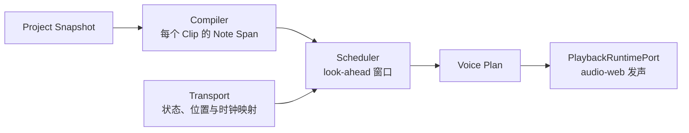

# Scheduler 工作原理

本文解释 playback 包里 Compiler、Transport 与 Scheduler 如何配合，把项目里的音符变成“在播放
时钟的某一秒开始、某一秒释放”的 Voice Plan。引擎如何在播放中处理编辑，见
[README](../README.md)。

## 1. 四个角色



- Compiler：项目里有哪些音符要播放，每一次出现从哪个 Tick 开始、到哪里松键、CC64 让它在哪里
  最终释放。结果按 Clip 存放（`plan.clipSpans`），每个 Clip 的 span 已按“起点、终点、occurrence
  key”排好序；没有改动的 Clip 在下一份计划里是同一个数组（ADR-007）。
- Transport：现在是否在播放、播放到哪里，以及项目时间如何对应播放时钟。
- Scheduler：接下来一小段时间里，哪些音符在播放时钟的哪一秒开始和释放。
- 输出：audio-web 按 Voice Plan 创建声音（ADR-006）。

## 2. 术语

| 名词                | 含义                                | 用途                                         |
| ------------------- | ----------------------------------- | -------------------------------------------- |
| `modelRevision`     | 计划来自哪一版项目                  | 确认 Transport 与 Scheduler 用的是同一份计划 |
| `mappingGeneration` | Transport 时间映射的代次            | 映射一变，Scheduler 就从新的 Anchor 重新规划 |
| occurrence          | 一个 Note 在编排中的一次出现        | 区分不同 Clip 与重叠的同音高 Note            |
| Anchor              | 项目时间与播放时钟的同步点          | 把 Tick 换算成播放时钟秒                     |
| Position / Playhead | 现在播放到哪里                      | Transport 与界面的当前时间                   |
| Scheduler cursor    | 未来已经安排到哪里                  | 保证窗口连续，不重复也不遗漏                 |
| cadence / horizon   | 多久唤醒一次 / 每次至少提前安排多远 | Studio 用 25 ms / 200 ms                     |
| Voice Plan          | 一枚 Voice 的排期，与浏览器无关     | 告诉输出播放什么、何时开始、何时释放         |

### 2.1 `mappingGeneration`

Transport 每改变一次播放时钟与项目位置的映射，就把 `mappingGeneration` 加一：

```text
第一次 Play       generation 1
Pause             generation 2
Resume            generation 3
Manual Locate     generation 4
Return to Anchor  generation 5
```

Scheduler 观察到更高的 generation 时，丢弃上一代的 cursor 与 Anchor，从新一代的映射重新规划。
已经交给输出的 Voice 由引擎处理：Pause、定位与 Return 让输出对全部 Voice 做 all-notes-off，
还没开始的 Voice 在起音前就被停掉。输出本身不认识 generation。

### 2.2 occurrence

两个 Clip 可以引用同一个 MIDI Source，同一个 Note 因此在编排中出现两次。occurrence key 是
`trackId + clipId + sourceId + noteId`。不能只用 `channel + pitch` 作身份：两枚同时发生的同音高
Note 必须是两个独立的 Voice，也要分别释放。

### 2.3 Anchor

Play 或 Resume 时，Transport 记下一对 Anchor，例如“项目第 0.25 秒对应播放时钟第 105.25 秒”：

```text
targetPlaybackClockSecond = anchorPlaybackClockSecond + targetProjectSecond - anchorProjectSecond
                          = 105.25 + 0.50 - 0.25 = 105.50
```

播放时钟是输出的 `AudioContext.currentTime`；动画帧和系统时间都不是音频调度的权威。

## 3. look-ahead 窗口

浏览器主线程的 Timer 会被布局、脚本或后台降频推迟。如果等到音符该响的瞬间才创建音频事件，
声音就会迟到。所以 Scheduler 持续把一小段未来提前交给输出：每 25 ms 唤醒一次，每次让未来
200 ms 内开始的音符都已安排好。horizon 必须大于 cadence，单次 Timer 抖动才不会耗尽提前量。

窗口是半开区间，并且从上一窗口的右端接着走，而不是从当前 Playhead 重新开始：

```text
第一次（Play 于 10.00）  [10.00, 10.20)
下一次（唤醒于 10.03）  [10.20, 10.23)
再下一次                 [10.23, ...)
```

所以窗口之间没有重叠，也没有空隙，恰好落在边界上的音符只属于后一个窗口。窗口在 Timeline
End 截断；内容结束之后，Scheduler 继续推进不含音符的空窗口，直到 Timeline End。

Playhead 表示现在播放到哪里，cursor 表示未来已经安排到哪里。cursor 总在 Playhead 之前，界面
不能用它显示播放位置。

## 4. `planNextWindow()`

```ts
planner.planNextWindow(transportSnapshot)
```

1. Transport 不在 Playing，就返回 `inactive`。
2. 遇到新的 generation，从它的 Anchor 重新定位：每个 Clip 的 cursor 指向第一枚起点不早于 Anchor
   的 span。
3. 计算窗口：`from` 是上次安排到的位置，`to = min(当前播放时钟 + horizon, Timeline End)`。
4. 每个 Clip 从自己的 cursor 往后读起点落在窗口里的 span，然后整批按 span 顺序排序，所以批次
   的顺序与 Clip 的顺序无关。
5. 用同一份 TempoMap 与 Anchor，把起点、松键与最终释放的 Tick 换算成播放时钟秒。
6. 处理迟到与过期（见下节），生成冻结的 Voice Plan，记下已经安排到哪里。

创建 Planner 只花与 Clip 数量成正比的时间；每个窗口花 Clip 数量加上本窗口开始的音符数。

## 5. Timer 迟到时

设有两个 span，而 Planner 第一次运行时已经到了 10.60：

```text
Note A: 10.00 开始，10.50 释放
Note B: 10.50 开始，10.75 释放
```

- Note A 的释放已经过去，直接丢弃：现在补播一枚已经结束的音符只会打乱节奏。
- Note B 已经过了起点，但释放还在未来：立刻开始（`timing: 'late-immediate'`），释放仍在 10.75。
  不会把整枚音符顺延到 10.60–10.85，那会改变项目里的节奏与音符终点。

## 6. 各种操作下的 generation

- Play：generation 1，Scheduler 从它的 Anchor 规划第一个窗口。
- Pause：generation 2，Scheduler 返回 `inactive`。
- Resume：generation 3，带新的 Anchor；Scheduler 重新定位 cursor。
- Manual Locate：产生新的 generation。Playing 时从目标往后继续；Stopped / Paused 时保持
  `inactive`。每次成功定位都替换 Return Anchor。
- Return to Last Start Position：产生新的 generation，回到 Stopped 与 Return Anchor。
- 自然结束：到达 Timeline End 时 Transport 进入 Stopped，不增加 generation；下一次 Play 从
  Tick 0 开始。

## 7. 不追赶已经开始的长音符

Resume 或定位的 Anchor 落在一枚长音符中间时，不会从中间重新触发它；下一枚起点在 Anchor
之后的音符照常安排。Note Chase 不只是补发 Note On，还要定义采样偏移、包络阶段、踏板、共鸣与
效果器状态，是一个独立的产品功能。

## 8. Voice Plan

```text
occurrenceKey, trackId
soundbankId, instrumentDeviceId
masterGain, trackGain, pan
pitch, velocity, channel
startPlaybackClockSecond
keyReleasePlaybackClockSecond   松键（Note Off）
releasePlaybackClockSecond      CC64 保持之后的最终释放
timing: on-time | late-immediate
```

输出不需要读项目模型：它只需知道用哪个音源、以什么音高与力度、在播放时钟的哪一秒开始、
哪一秒松键、哪一秒释放。释放可以落在当前窗口之外；起点在窗口里，就把完整的释放目标一起
交出去。

## 9. Planner 检查什么

只检查调用方给的配置：cadence 与 horizon 必须是合法的时长，horizon 必须大于 cadence。

其余都由上游保证，Planner 不再检查：编译出的计划里 span 有效、每个 Clip 内有序、occurrence key
唯一、所属 Track 可发声；Snapshot 来自同一份计划的 Transport，同一 generation 的 Anchor 不变，
播放时钟只会前进。Transport 与 TempoMap 也同样信任计划，不重新校验 Tempo Segment。

## 10. 实现与测试

- [Compiler](../src/compiler/audible-midi-compiler.ts) 与 [计划类型](../src/compiler/audible-midi-plan.ts)
- [Transport](../src/transport/audible-midi-transport.ts)
- [Scheduler](../src/scheduler/audible-midi-scheduler.ts) 与[测试](../src/__tests__/audible-midi-scheduler.spec.ts)
